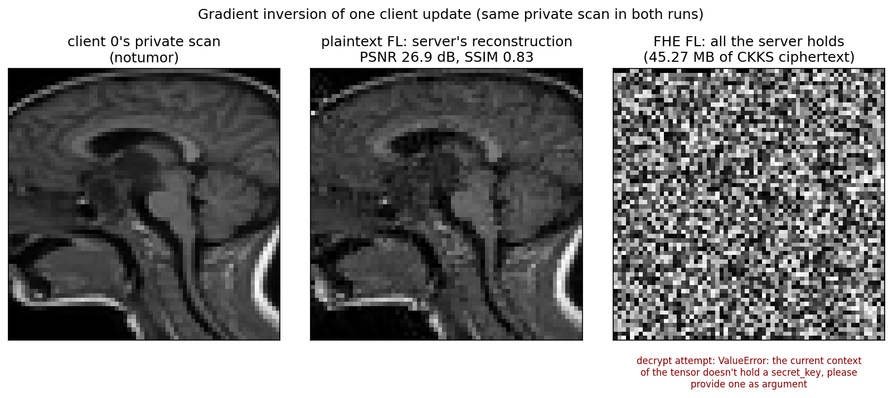
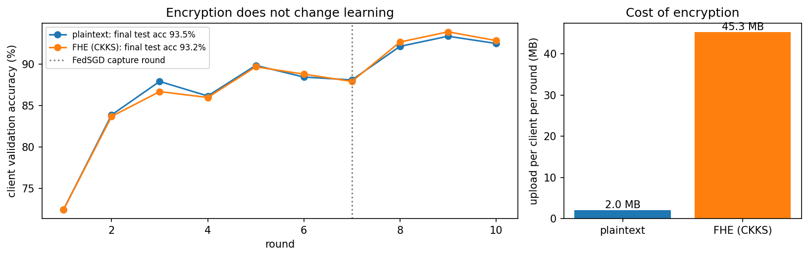
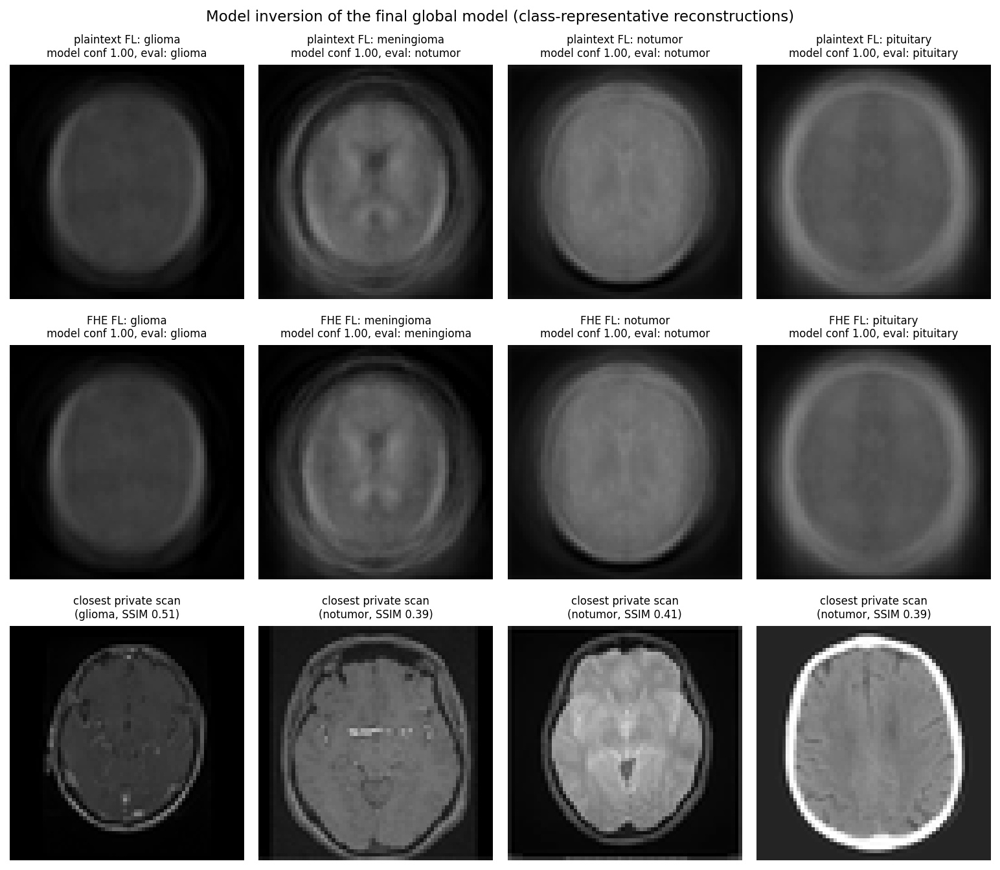

# Quantum Federated Learning: privacy attacks with and without FHE

This repository builds on [QFL-MLNCP](https://github.com/elucidator8918/QFL-MLNCP-NeurIPS), the code for
*Federated Learning with Quantum Computing and Fully Homomorphic Encryption*
([arXiv:2409.11430](https://arxiv.org/abs/2409.11430)), and asks what fully homomorphic encryption (FHE)
actually protects in federated learning (FL).

Three simulated hospitals train a brain-tumour MRI classifier with [Flower](https://flower.ai). The training is attacked
twice, once with plaintext updates and once with every update encrypted under CKKS ([TenSEAL](https://github.com/OpenMined/TenSEAL)):

- a **gradient inversion attack (GIA)**: the server rebuilds a client's private scan from that client's update;
- a **model inversion attack (MIA)**: anyone holding the final model recovers what each tumour class looks like.

## Results

From [`src/FL_Privacy_Attacks_MRI.ipynb`](src/FL_Privacy_Attacks_MRI.ipynb): 3 clients, IID split, 10 rounds, CPU only.

| | Plaintext FL | FHE FL (CKKS) |
|---|---|---|
| Test accuracy of the final model | 93.49% | 93.23% |
| Upload per client per round | 2.0 MB | 45.3 MB |
| Training time (10 rounds) | 100 s | 120 s |
| GIA on one client update | **reconstructed** (PSNR 26.9 dB, SSIM 0.83) | **blocked**: the server has no secret key |
| MIA attack accuracy (independent classifier) | 3 / 4 classes | 4 / 4 classes |

Multithreaded CPU training is not bit-for-bit reproducible. Across two full runs the test accuracy moved by
under half a point, the GIA reconstruction scored PSNR 26.9 to 29.1 dB (SSIM 0.83 to 0.89), and MIA attack
accuracy was 3 or 4 of 4 classes for each model.







What this shows:

1. With plaintext updates, the server rebuilds a client's private scan almost exactly from a single-image update,
   including the label (recovered analytically).
2. With CKKS, the server only ever holds ciphertext and the public key. It still averages the updates, but it cannot
   decrypt any of them. Accuracy is unchanged; each upload is about 22 times larger.
3. FHE does not protect the finished model. Clients decrypt it to use it, and model inversion recovers
   class-representative images from both the plaintext and the FHE model.

## Threat model and limitations

- **Attacker for GIA:** an honest-but-curious server. In one round (`capture_round`) clients send a single SGD step on
  one image (FedSGD), the setting studied by DLG, iDLG and Geiping et al. All other rounds use FedAvg with 2 local
  epochs over about 1,700 images; updates like that are much harder to invert.
- **One shared key:** all clients use the same CKKS key pair, so FHE protects updates from the server, not from a
  client that colludes with it. Threshold or multi-key HE would be needed for that.
- **MIA output:** the reconstructions are class prototypes, not specific patients. They are scored by an independent
  classifier trained on the private data (attack accuracy, as in Zhang et al. 2020). The image prior is a PCA fitted on
  the held-out Testing split, treated as public data.
- **Scale:** 64x64 grayscale scans and a 0.5M-parameter CNN, small enough to encrypt every weight every round on a laptop.

## Fixes to the original QFL code

- **FHE encrypted nothing.** `crypte()` in `src/utils/security.py` came from a Flower + TenSEAL tutorial
  ([data-science-lover/flower-homomorphic_encryption](https://github.com/data-science-lover/flower-homomorphic_encryption))
  and encrypted only a layer named `fc3.weight`. The tutorial's LeNet has that layer; none of the QFL models do, so every
  "FHE" run sent plaintext. Every tensor is now packed into batched CKKS ciphertexts. The upstream QFL repository still has
  this issue.
- **TenSEAL batching bug** (0.3.16 to 0.3.18, the latest release): a batched tensor whose last axis has size 1
  encrypts its first value into every slot. `encrypt_array` always uses at least two ciphertexts per tensor to avoid
  it. Fix submitted upstream: [OpenMined/TenSEAL#534](https://github.com/OpenMined/TenSEAL/pull/534).
- FedAvg over ciphertexts uses one plaintext-scalar multiply per update (fits the CKKS level budget), and decryption
  restores each layer's shape.
- The QNN MRI notebooks requested 2 GPUs even on CPU-only machines, which leaves Ray waiting forever; GPUs are now
  requested only when CUDA is available.
- The non-IID MRI split reads labels from the dataset index instead of decoding every image.
- With real encryption, the FHE notebooks' clients crashed in Flower's Ray workers (`np.save` on a CKKS
  tensor): the notebooks patched Flower's converters only in the notebook process. `utils` now installs
  CKKS-aware converters in every process that imports it.
- `qml.device("default.qubit.torch")` no longer exists in PennyLane; the notebooks use `default.qubit`.
- The MRI FedNN notebooks' `evaluate()` called undefined helpers, reported 0 examples on the resulting
  error, and crashed the server with a division by zero; it now uses `set_parameters` and `engine.test`.

## Setup

```bash
conda create -n fed python=3.10
conda activate fed
bash run-cpu.sh        # or run-gpu.sh

# Brain-tumour MRI dataset (needs a Kaggle API token)
cd src
kaggle datasets download -d masoudnickparvar/brain-tumor-mri-dataset
mkdir -p data/MRI && unzip brain-tumor-mri-dataset.zip -d data/MRI && rm brain-tumor-mri-dataset.zip
```

## Run

```bash
cd src
jupyter nbconvert --to notebook --execute --inplace FL_Privacy_Attacks_MRI.ipynb   # or open it in Jupyter
```

The full run takes about 10 minutes on a 12-core CPU. Outputs go to `src/results/` (figures, `summary.json`, per-mode
reports); CKKS keys go to `src/keys/`. Both folders are git-ignored.

## Repository layout

```
src/
  FL_Privacy_Attacks_MRI.ipynb   main experiment: training, GIA, MIA, summary
  federated.py                   Flower client and strategy, plaintext or CKKS updates, server-side recording
  gia_attack.py                  gradient inversion (iDLG label, analytic FC input, cosine + TV matching)
  mia_attack.py                  model inversion with a PCA image prior and an evaluation classifier
  models.py                      MRINet (attacked model) and EvaluationNet (scores MIA)
  utils/security.py              CKKS encryption of model weights, FedAvg over ciphertexts
  utils/data_setup.py            datasets, cached 64x64 MRI arrays, IID / non-IID splits
  utils/common.py, engine.py     parameter get/set, plotting, train/test loops
  {Standard,FHE}_Fed{NN,QNN}_{CIFAR,MRI}.ipynb   original QFL notebooks (see below)
tests/                           SEFOP-style pytest suite (unit tests mirror src/; integration/ runs Flower)
.github/workflows/               CI: unit tests on every push and pull request
.claude/skills/                  Claude Code skills: ibm-quantum, sefop-tests
docs/figures/                    figures used in this README
docs/FL_FHE_ECE_59500.pptx       ECE 59500 presentation of these results
```

## Original QFL notebooks

The eight notebooks from QFL-MLNCP train classical (NN) and quantum-hybrid (QNN, PennyLane) models on CIFAR-10
and MRI at 224x224. A first smoke test (1 round, 1 local epoch, 2 clients) found the notebook issues listed under
"Fixes to the original QFL code"; the notebooks have not been re-run after those fixes. With every layer now
encrypted, an FHE update of the 224x224 MRI model is about 3,100 ciphertexts (roughly 1 GB) per client per round,
so the FHE notebooks need far more memory and time than the 64x64 experiment above.

## Tests

The suite follows SEFOP conventions (the `sefop-tests` skill): one test file per module, names of the form
`test__unit__scenario__outcome`, Arrange / Act / Assert, and expected values from an oracle, never from the code
under test (hand calculations, autograd gradients, encrypt/decrypt identities, the server's inability to decrypt).

```bash
pytest -m "not integration"          # 99 unit tests, about 10 s, no dataset needed
pytest -m integration                # 2 end-to-end Flower simulations (plaintext and FHE), about 25 s
pytest --cov=src --cov-report=term-missing
```

A mutation check (`tests/mutations.json`, 12 deliberate bugs such as a sign flip in the server's gradient, an
unweighted FedAvg or a single-ciphertext tensor) is caught in full by the unit tests:

```bash
python .claude/skills/sefop-tests/scripts/mutation_check.py --repo . --mutations tests/mutations.json \
    --pytest-args "-m 'not integration' -x -q -p no:cacheprovider"
```

### Known bugs

Each is pinned by a strict `xfail` test that states the correct behaviour; fixing the bug makes that test pass
and the run fail until the marker is removed.

| ID | Severity | Where | What happens | Test |
|---|---|---|---|---|
| BUG-01 | M | `src/utils/engine.py`, `test()` and `train_step()` | Accuracy and loss are averaged over batches, not samples, so a smaller last batch is over-weighted (3 samples, batch 2: reports 50% instead of 66.7%). Reported test accuracies are affected slightly. | `tests/utils/test_engine.py` |
| BUG-02 | L | `src/mia_attack.py`, `nearest_private_images()` | Asks `torch.topk` for 10 neighbours even when fewer private images exist, and raises. | `tests/test_mia_attack.py` |

## Claude Code skills

- `.claude/skills/ibm-quantum` sets up and verifies access to IBM Quantum hardware (IBM Quantum Platform via
  qiskit-ibm-runtime) and estimates what a hardware run costs. Credentials are stored by qiskit in your home
  directory, never in the repository.
- `.claude/skills/sefop-tests` writes and audits SEFOP-style test suites; it produced `tests/`.

Claude Code picks both up automatically inside this repository.

## References

- Zhu, Liu, Han. *Deep Leakage from Gradients.* NeurIPS 2019.
- Zhao, Mopuri, Bilen. *iDLG: Improved Deep Leakage from Gradients.* 2020.
- Geiping, Bauermeister, Dröge, Moeller. *Inverting Gradients: How easy is it to break privacy in federated learning?* NeurIPS 2020.
- Zhang et al. *The Secret Revealer: Generative Model-Inversion Attacks Against Deep Neural Networks.* CVPR 2020.
- Dutta, Karanth, Xavier, de Freitas, Innan, Ben Yahia, Shafique, Bernal Neira. *Federated Learning with Quantum
  Computing and Fully Homomorphic Encryption: A Novel Computing Paradigm Shift in Privacy-Preserving ML.*
  arXiv:2409.11430, 2024.

## License and credits

MIT, see [LICENSE](LICENSE). The QFL notebooks and utilities come from
[elucidator8918/QFL-MLNCP-NeurIPS](https://github.com/elucidator8918/QFL-MLNCP-NeurIPS). The CKKS helpers in
`src/utils/security.py` are adapted from
[data-science-lover/flower-homomorphic_encryption](https://github.com/data-science-lover/flower-homomorphic_encryption)
(Apache-2.0).
